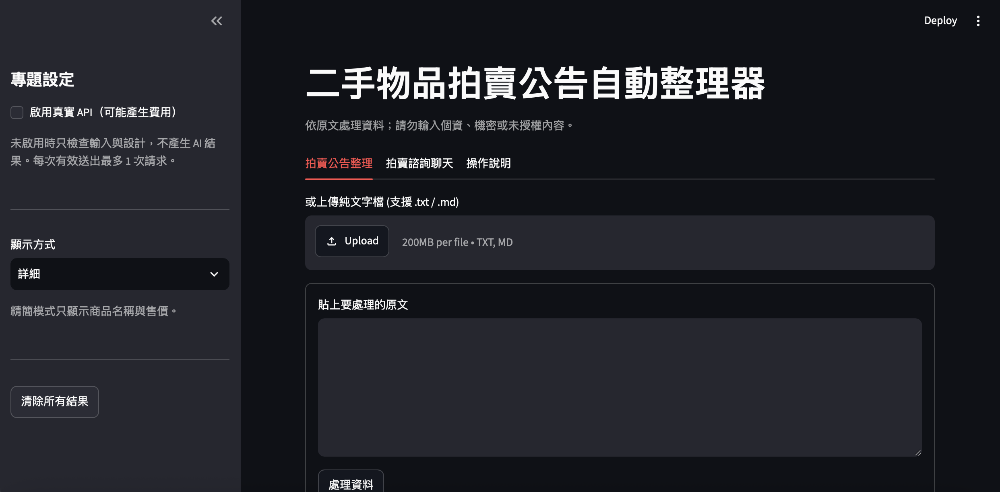
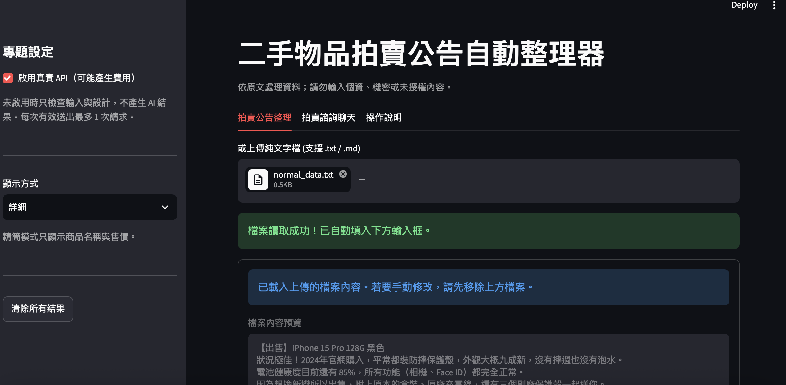
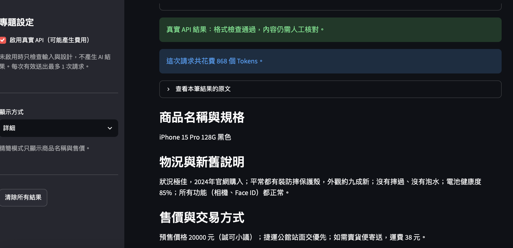
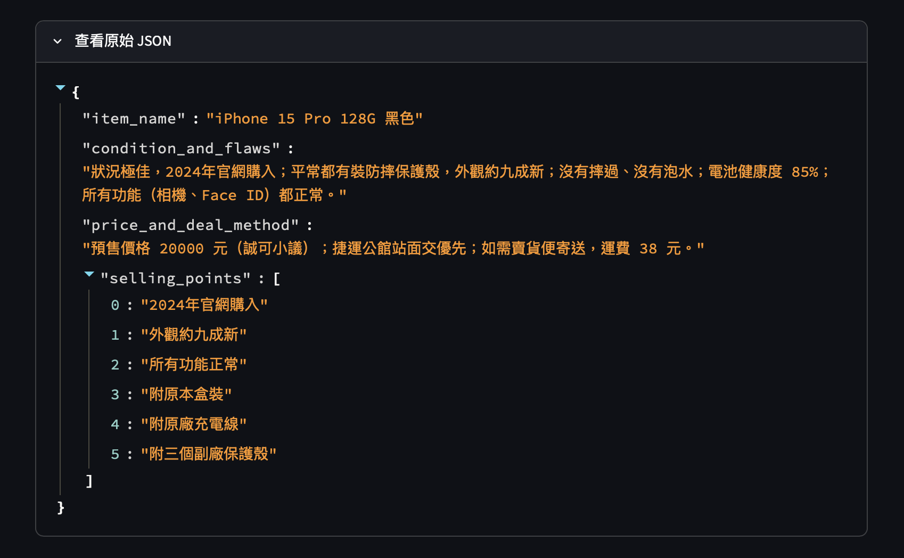
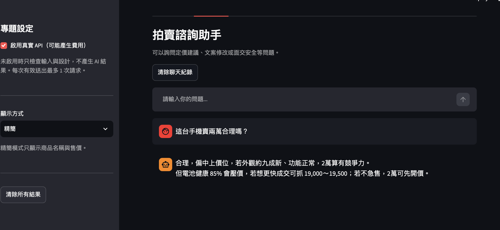

# 第 8 週｜個人專題設計與驗收紀錄

請複製後自行填寫。這是紀錄表，空白不代表通過；不可填入真實金鑰或個資。

## 一、自己的問題與設計

| 項目 | 我的內容 |
|---|---|
| App 名稱／作者 | 二手物品拍賣公告自動整理器/ A113222009 王煦 |
| 目標使用者與情境 | 在二手社團、Dcard、蝦皮拍賣等出售個人物品的賣家。將隨手寫下的混亂描述文字貼入，快速整理為規格分明、項目清楚的拍賣公告資訊。 |
| 想完成的一個任務 | 自動將非結構化的商品描述萃取為「商品名稱與規格」、「物況與新舊說明」、「售價與交易方式」、「核心賣點與配件」4 個標準化欄位；若原文資訊不足時，自動標註「原文未提供」。 |
| 輸入資料與範圍 | 支援兩種輸入方式：1. 透過 Streamlit 文字輸入框貼上原文；2. 上傳 .txt 或 .md 純文字檔（自動進行 UTF-8 編碼檢查與 6000 字元長度限制）。點選「處理資料」按鈕才提交。|
| 資訊不足如何處理 | 任務 Prompt 明確規定模型必須嚴格依據原文，若缺乏價格、地點或狀態時，必須明確標示「原文未提供」，不可發揮想像力憑空捏造事故事實。 |
| 採用 starter 或自行實作 | 採用課程提供的 `week08_midterm_simple_pydantic_starter` 進行修改。選擇理由是利用 starter 已定義好的流程，能確保 API 開關與離線防呆機制完全符合課堂安全性規範。 |
| 結構化輸出路線 | Pydantic 路線。選擇理由是運用 Pydantic 的 `BaseModel` 搭配 `ConfigDict(extra="forbid", strict=True)` 能夠發揮強型別校驗優勢，確保 API 輸出欄位絕對符合契約，不會產生額外無效欄位。 |
| 相較教師範例的個人設計 | 將原教師範例完全替換為二手商品的賣場自動整理情境；設計了 4 個全新且有業務價值的欄位。此外，加入了側邊欄設定、分頁 UI、Token 用量顯示、檔案上傳功能，以及串流聊天回應。 |

## 二、輸出欄位契約

至少兩個有用途的欄位；可自行加列。

| 欄位名稱 | 型別／限制 | 用途 | 畫面標籤 | 如何查原文 |
|---|---|---|---|---|
| `item_name` | `str`；必填、非空白 | 商品名稱與品牌規格 | 商品名稱與規格 | 核對品牌、型號、容量是否一致。 |
| `condition_and_flaws` | `str`；必填、非空白 | 物況與新舊折舊狀況 | 物況與新舊說明 | 逐句核對新舊程度與瑕疵描述。 |
| `price_and_deal_method` | `str`；必填、非空白 | 售價與交易方式 | 售價與交易方式 | 核對價格、面交地點或運費說明。 |
| `selling_points` | `list[str]`；可為 `[]`，項目須非空白 | 核心賣點與附贈配件 | 核心賣點與配件 | 每項都要能在原文找到對應依據。 |

## 三、測試紀錄
*(註：以下為實際測試操作紀錄，真實 API 皆使用 `gpt-5.4-mini` 模型進行)*

| 項目 | 實際輸入／操作 | 實際輸出／錯誤 | 人工判讀與修正 | 證據類型 |
|---|---|---|---|---|
| 空白 | API 關閉，輸入三個空白字元並點擊處理。 | 顯示「請先輸入要處理的原文。」；0 次請求。 | 提示清楚，沒有發出無效請求。 | 離線操作 |
| 過長 | API 關閉，輸入 6001 個字元並點擊處理。 | 顯示「請縮短到 6000 字元以內」；0 次請求。 | 系統正確攔截，未默默截斷原文。 | 離線操作 |
| 正常資料 | 於雲端啟用 API，上傳 normal_data.txt 檔案，內容包含：「售 iPhone 15 Pro 128G 黑色，2024年購入，外觀9成新，電池健康度85%，附原廠線，賣20000元，公館捷運站面交。」 | 成功輸出 4 欄位 JSON。item_name: "iPhone 15 Pro 128G 黑色"；price_and_deal_method: "賣20000元，公館捷運站面交" 等。 | 逐欄對照原文皆吻合，無捏造規格，Token 用量顯示正常。 | 雲端真實 API |
| 資訊不足 | 於雲端啟用 API，上傳 lack_info_data.txt 檔案，內容為：「出售一台二手筆記型電腦，狀況良好，有興趣的請私訊我。」 | 成功輸出。condition_and_flaws: "原文未提供"；price_and_deal_method: "原文未提供"。 | 模型正確標示「原文未提供」，無自行捏造售價或物況。 | 雲端真實 API |
| 結果保存／再送出失敗 | 成功產生結果後，將輸入框清空並再次點擊處理。 | 畫面紅字顯示「請先輸入要處理的原文。」，先前的成功結果被清除。 | 舊結果有被正確清除，未與新錯誤混淆。 | 離線操作 |
| 缺 key／服務失敗 | 在無 `.env` 與 Secrets 的環境下啟用 API 並送出。 | 顯示「缺少 OPENAI_API_KEY，請設定本機 .env 或平台 Secrets。」；0 次請求。 | 系統在金鑰缺失時即時停止，未發出請求。 | 離線操作 |
| Cloud 部署（必做） | 已於 11/6 將專案部署至 Streamlit Cloud。 | 網址：https://1151genai-app-development-8ue3om8dtr9umdemzybq6w.streamlit.app/】。操作正常，正常與資訊不足測試皆成功。 | 老師可開啟並操作，雲端真實 API 請求共計 2 次。 | 雲端真實 API |

## 畫面截圖

以下為本專案的實際操作畫面：

**1. 首頁與側邊欄（支援精簡/詳細切換與檔案上傳）**

**2. 結構化輸出結果（包含 Token 用量顯示）**

**3. 拍賣諮詢聊天（結合歷史紀錄與串流輸出）**

## 四、環境、交付與反思

| 項目 | 填寫內容 |
|---|---|
| 本機環境 | Windows／Python 3.14.0／Streamlit 1.63.0／OpenAI SDK 2.49.0／python-dotenv 1.2.3／Pydantic 2.14.1。 |
| GitHub | https://github.com/a113222009whsu/115_1_GenAI-App-Development.git |
| 啟動方式 | 建立 Python 3.14 虛擬環境後，安裝 `requirements.txt`，設定 `.env`，執行 `python -m streamlit run app.py`。 |
| 部署網址 | https://1151genai-app-development-8ue3om8dtr9umdemzybq6w.streamlit.app/|
| 部署設定與驗收 | 分支：`main`；入口：`Midterm Mini-Project/app.py`；Cloud Python 版本：3.12。驗收日期：11/6，驗收結果：成功。 |
| 老師觀看權限 | 已公開。 |
| 本次請求數 | 共 2 次（正常 1 次＋資訊不足 1 次）；追加 0 次。 |
| 尚未完成的驗證 | 無。 |
| AI 協助內容 | 協助將 Week 5 聊天歷史功能與 Week 7 UI 分頁與側邊欄，整合進原有的 Pydantic starter 架構中，並協助整理驗收文件格式。 |
| 自己的修改與驗證 | 親自設計了 4 個專屬欄位，並實際輸入不同的二手商品文案來測試。發現模型會漏掉「原文未提供」的指示，因此強化了 `INSTRUCTIONS` 中的防呆限制，並親自於雲端截圖驗證。 |
| 最有用的欄位與反思 | `price_and_deal_method` 最有用，因為賣家常常忘記寫運費或面交地點。這次遇到最大的問題是 Streamlit 狀態被覆蓋，後來透過 st.session_state 加上切換模式清除的邏輯解決了。實作檔案上傳時，也學會了使用 utf-8-sig 來避免 Windows 記事本造成的 BOM 亂碼問題。未來若延伸此專案，希望能結合 PDF 等解析功能，讓使用者上傳格式更複雜的二手商品報價單。 |

